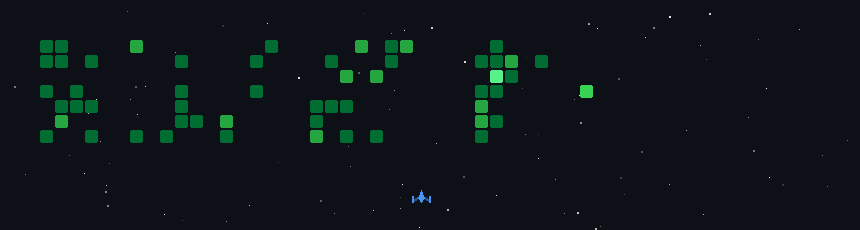

<h2 align="center">👋 Welcome to My GitHub Universe</h2>

  

  

 

<h2 align="center">🎮 My GitHub Activity Graph</h2>

  

 

<h2 align="center">🚀 About Me</h2>

<h3>💻 Full-Stack Developer passionate about crafting scalable web applications</h3>

<h3>🤖 Exploring AI, Algorithms, and Systems Engineering</h3>

<h3>🌐 Skilled in MERN Stack, PostgreSQL, and modern tools</h3>

<h3>🎨 Focused on intuitive, responsive, high-performance UI/UX</h3>

<h3>☕ Currently learning Java, Spring Boot, Generative AI (GenAI), and related frameworks & tools</h3>

 

<h2 align="center">🌎 Connect With Me</h2>

  
  
  
  

  
  

 

<h2 align="center">⚒️ Tech Stack</h2>

<!-- Programming Languages -->
<h3 align="center">🔹 Programming Languages</h3>

  
  
  
  
  
  

<!-- Web Technologies -->
<h3 align="center">🔹 Web Technologies</h3>

  
  

<!-- Frontend -->
<h3 align="center">🔹 Frontend Development</h3>

  
  
  
  
  
  
  

<!-- Backend -->
<h3 align="center">🔹 Backend Development & Frameworks</h3>

  
  
  
  
  
  

<!-- Microservices -->
<h3 align="center">🔹 Microservices & Distributed Systems</h3>

  
  
  
  
  
  

<!-- Databases -->
<h3 align="center">🔹 Databases & Data Management</h3>

  
  
  
  
  
  
  

<!-- AI & GenAI -->
<h3 align="center">🔹 AI, Generative AI & Emerging Technologies</h3>

  
  
  
  
  
  

<!-- Security -->
<h3 align="center">🔹 Security & Authentication</h3>

  
  
  

<!-- Developer Tools -->
<h3 align="center">🔹 Developer Tools & IDEs</h3>

  
  
  
  
  
  
  
  
  
  

<!-- DevOps -->
<h3 align="center">🔹 DevOps, Cloud & Deployment</h3>

  
  
  
  
  
  

<!-- Monitoring -->
<h3 align="center">🔹 Monitoring & Observability</h3>

  
  
  
  

<!-- Testing -->
<h3 align="center">🔹 Testing & Quality Assurance</h3>

  
  
  
  

<!-- Coursework -->
<h3 align="center">🔹 Coursework & Core Concepts</h3>

  
  
  
  
  
  
  
  

<!-- Other Technologies -->
<h3 align="center">🔹 Other Technologies & Methodologies</h3>

  
  
  

<!-- Soft Skills -->
<h3 align="center">🔹 Soft Skills</h3>

  
  
  
  
  

 

<h3 align="center">Thanks for visiting — let's build something awesome together! 🚀✨</h3>

  

